# Dashboards as code

A dashboard here is **one YAML file** that names things in the Cube semantic layer (measures and dimensions) and says how to lay them out.
No SQL, no JavaScript. A validator checks the file, a renderer draws it at `/d/<id>`, and every number comes from Cube, so metric
definitions, row-level security and rollups stay in one place. A new dashboard is a reviewed file, not a new code base, and a Claude Code
skill can write it from a request.

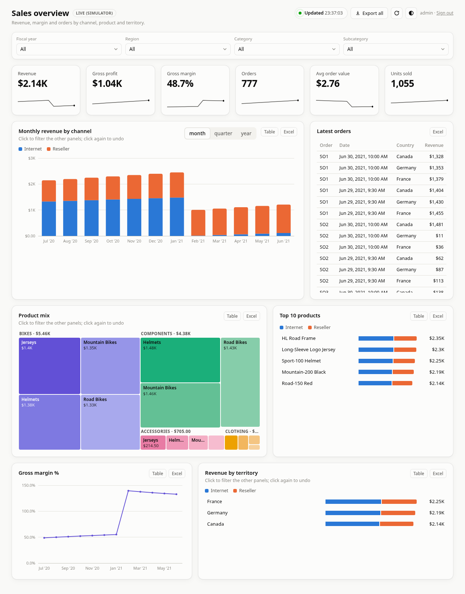
*[`dashboards/sales-overview.yml`](../dashboards/sales-overview.yml) rendered from generated data (the numbers mean nothing; the layout, formats and interactions are real).*

- Reference of every field: [dashboard-spec-reference.md](dashboard-spec-reference.md) (generated from the schema).
- What you can ask for: the semantic layer, with every cube, measure and dimension, what it means and who may read it: [semantic-layer.md](semantic-layer.md) (generated from the Cube model). `scripts/dashspec meta` prints the same in the terminal.
- Describe a dashboard instead of writing it: [the builder](../builder/README.md); running it, its limits and what it sends out: [builder.md](builder.md).
- Why and how it was built, phase by phase: [dashboard-spec-plan.md](dashboard-spec-plan.md).
- The hand-written sales dashboard at `/` stays as it is: it is the showcase and the reference for look and behaviour. The inventory
  actions (Approve, campaigns, proposals) are an application, not a dashboard, and live only there.

## Five minutes to a new dashboard

```bash
scripts/dashspec meta                              # the cubes, measures and dimensions you may use (and which cubes join)
cp dashboards/sales-overview.yml dashboards/my-page.yml    # start from the closest example; the file name is the id
$EDITOR dashboards/my-page.yml                     # change id, title, panels, layout
scripts/dashspec validate dashboards/my-page.yml   # every message names the panel and the field
scripts/dashspec build                             # compiles dashboards/*.yml into the committed dashboards/build/
uv run --with playwright python -I dashboard/cube/tests/shot.py my-page --role admin    # a screenshot, no stack needed
```
Then open `http://localhost:<DASHBOARD_CUBE_PORT>/d/my-page` on a running stack (`/d/` lists what your role may open), commit the YAML **and**
the rebuilt `dashboards/build/*.json`, and open a PR. `scripts/dashspec` needs only [`uv`](https://docs.astral.sh/uv/).

Or ask Claude Code: the [`dashboard-author`](../skills/dashboard-author/SKILL.md) skill does these steps (and refuses to invent a metric).

## Describe a dashboard instead of writing it
On `/d/` there is a box: say what you want ("monthly revenue by channel and the top 5 products, with a table of the latest orders") and the
[builder](../builder/README.md) drafts the YAML for **your role**, checks it with the same validator, and draws it at `/d/draft`. Change it in words, edit the
YAML, browse the [semantic layer](semantic-layer.md) next to it, save it (private, or shared with roles or everyone; [details](builder.md#saved-dashboards)), download the file, and send it through a pull request when it should become part of the product.
Until an API key is configured, a rule-based stand-in answers (a fixed set of phrases, not free text); with a key, Claude does.

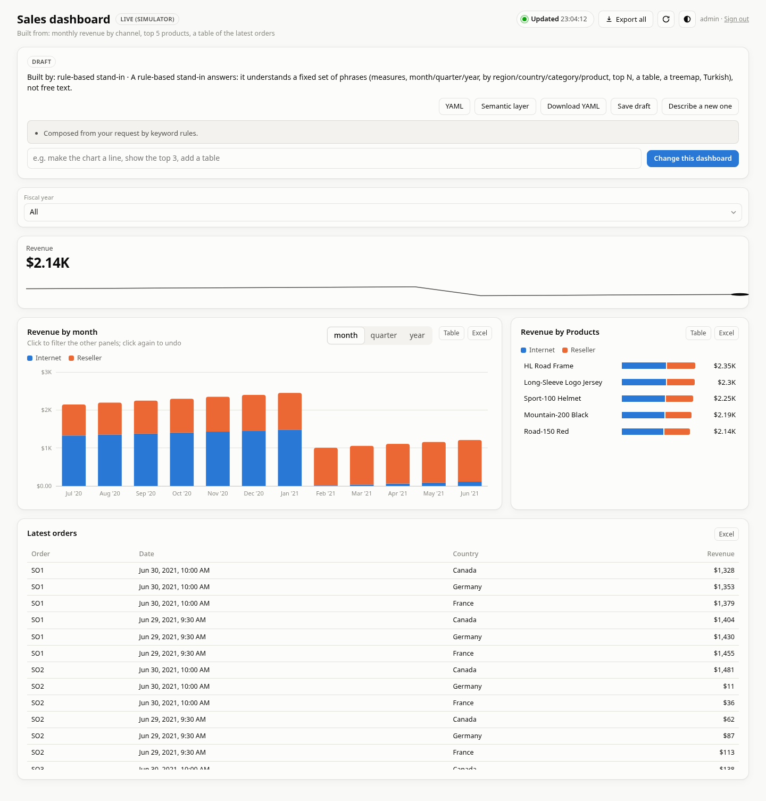

## Tabs
A dashboard can have **pages** instead of one long page: write `tabs` instead of `layout`, 2 to 8 entries, each with an `id` (used in the address), a `title` (up to 40
characters) and its own `layout` rows. `panels` stays one flat list and each panel is placed in exactly one tab. The validator names the tab in its messages
(`tab 'details': row 2: the widths add up to 11`, `tabs: panel 'kpis' is placed 2 times (tab 'overview' and tab 'details')`).

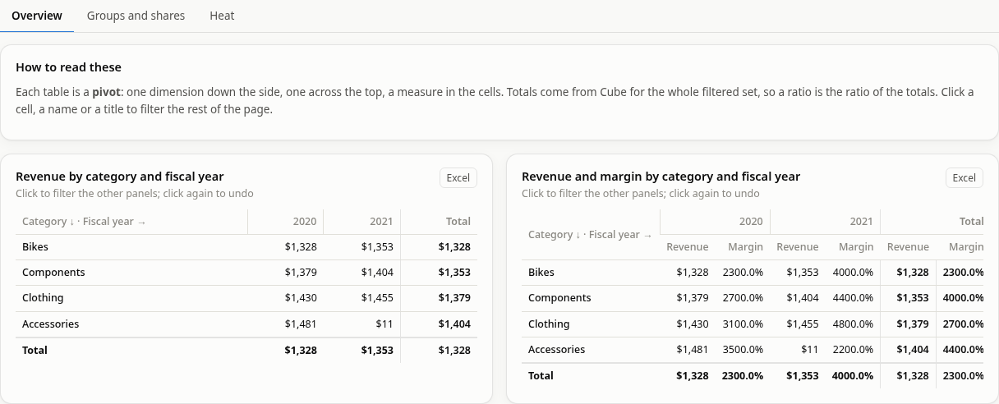

`dashboards/pivot-gallery.yml` is a real example: three tabs (Overview, Groups and shares, Heat), so opening it asks Cube for 12 of its 33 queries; the rest wait for their tab.

On the page a tab bar sits under the filters. **The filters and a drill-down's period are shared by all tabs**, so a filter chosen on one tab applies on the others. **Only the open
tab's panels are loaded**: a dashboard with three tabs costs one tab's queries when it opens, a tab loads the first time you open it, and going back to one you have seen
sends nothing. A tab always shows numbers for the current filters (it reloads when a filter changed while you were elsewhere) and is reloaded when you open it after the refresh
interval (5 minutes); Refresh and the automatic refresh reload the open tab. **Export all** takes every tab (it loads the ones you never opened first). The open tab is in the address
(`?tab=details`; the first tab leaves it out), so it can be linked and survives a reload and a change of language; a name the dashboard does not have opens the first tab.
Keyboard: Tab reaches the open tab, the arrow keys move to the next or previous tab and open it (they wrap), Home and End go to the first and the last. On a phone the bar scrolls sideways
inside itself. The **builder** knows tabs: a language model is told to use them only when the request asks for pages or separate topics (or the dashboard would pass about 8 panels) and is
shown how; its mistakes come back naming the tab. A tabbed draft or saved dashboard works like any other (save, share, versions, tags); a saved dashboard from before tabs opens unchanged. The rule-based
builder (no API key) does not write tabs and will not change a dashboard that has them (it would flatten them): edit the YAML, or use a language model.

## Language
Every `/d` page has a small **EN | TR** switch in its header. The choice is kept in this browser (or, when the browser keeps nothing, in the address as `?lang=tr`, which also
lets a link carry it) and the page is drawn again in that language: its own words (buttons, status, empty states, the builder's boxes and examples, what a screen reader
hears), its dates and its number formats (`1,234.56` or `1.234,56`, month names). Until you choose, a dashboard speaks its own `locale` and the list the browser's language.
What is **not** translated is what someone wrote: a dashboard's titles, labels and notes, the data-set name from the configuration, and the builder's explanations
(`notes`, validator messages). The currency stays the dashboard's: a lira dashboard read in English shows `TRY 4,200`, in Turkish `₺4.200`.

## The designer
A draft has a third way to change it besides describing the change or editing the YAML: the **Design** button in the draft bar. In design mode every panel is outlined and
a click picks one (it does not filter the page); a drawer on the right (a sheet at the bottom on a phone) shows the panel's fields: its title, the measures, what it groups
by, the style and time step of a time chart, sort, limit, direction and format of a bar, the slices of a pie, the columns of a table, the text of a note. The lists hold only
what you may read **and** what Cube can answer for that panel: a bar adding two sales channels offers only the groupings both channels join to. A change is checked by the same
validator that checks a model's answer; if it is accepted the draft is updated and the page is drawn again with the panel still picked, and if not, the drawer says why and the draft
stays as it was. Changing what a panel groups by removes its click rule (it pointed at a filter on the old grouping) and says so.

With nothing picked (or after Escape) the drawer is the **page** view: the dashboard's title, description, language, currency and time field; its **filters** (label, the field it filters by,
the field it is narrowed by, remove, and add a new one); and a gallery of the eight **panel types** to add. A new panel starts with a measure you may read (revenue first, and for a time chart one that can be
put on the time axis) and a grouping its cube can join to, and goes in a full-width row at the end of the layout (of the open tab, when the dashboard has tabs). A picked panel can be **duplicated** (a copy under the original) or
**deleted**; the neighbours in its row widen so the row still adds up to 12. A filter on a field some panels cannot join to is added to those panels' `ignore_filters` for you (the drawer says so), and removing a
filter cleans up every mention of it.

The designer edits the same file as everything else, so the YAML tab, the Change box and **Save** keep working with it, and a designed draft is a normal draft. Still in the YAML for now:
formulas (`sum`, `ratio`), moving panels and their widths, tabs; the plan for those is in [`PLAN-designer.md`](../PLAN-designer.md).

## Themes
The round half-moon button in every header opens a menu of themes: **Light**, **Black** (the original dark one), **Slate** (dark blue-grey), **Navy** (deep blue),
**Sand** (warm light), **Mint** (cool light with a green accent) and **High contrast** (black and white with a yellow focus ring), or **System**, which follows the
operating system and is the default. The choice belongs to the viewer and is kept in this browser; it works on the sales page and on every `/d` page. The words
follow the page's language ("Siyah", "Lacivert"…).

A theme is a block of colour tokens in [`dashboard/static/themes.css`](../dashboard/static/themes.css) (Light and Black are in `style.css`); to add one, copy a block,
change the colours, add a line to `THEMES` in `dashboard/static/lib/theme.js`, and run `node --test dashboard/cube/tests/themes.test.mjs`, which checks every theme for
body and secondary text at 4.5:1 on the page, the cards and the shaded cells, series, status and focus colours at 3:1, and the text on a primary button at 4.5:1.
A dashboard's own `theme.colors` (its brand) still win over the viewer's theme, so a branded dashboard keeps its colours in every theme. The categorical palette of
the treemap, the pie and the heat shades is the same in every theme.

## Finding a dashboard
Every dashboard page has a **Dashboards** link above its title that leads back to the list at `/d/`. On the list, the search box above the dashboards filters
as you type: the built dashboards and, when the builder keeps them, your saved ones and those shared with you. It looks at the title and description (and, for
saved dashboards, the owner), ignores case and accents with Turkish rules (`satis` finds "Satış", `SAGLIG` finds "sağlığı"), needs every word you type (in any
order) and treats the text literally, so a bracket is just a bracket. Each saved list shows its own count while you search, `/` jumps to the box, Escape or
the ✕ clears it, and nothing is asked of the server while you type.

The search also understands meaning, endings and slips, in Turkish and English: "gelir" finds "revenue", "satışlar" finds "Sales", "gelirleri" finds "gelir"
and "revnue" finds "revenue". The meanings live in `dashboard/static/lib/synonyms.js`, one line per group of words (add a word to the line of its meaning;
nothing else changes). A meaning matches whole words only, the lines are not chained (asking for "revenue" does not give "sales"), a word of five letters
or more forgives one slip (a missing, extra, wrong or swapped letter), and a known ending is cut off (`ler`, `lar`, `leri`, `nin`, `de`, `den`…, and the
English `s`, `es`, `ed`, `ing`). It is not a language model: a word the dictionary does not know is still looked for as plain text, and "sağlık" and
"sağlığı" stay different words.

**Tags.** A dashboard can carry up to five `tags` (`tags: [sales, management]`): short, lower-case, letters of any language, digits, spaces and hyphens, at most 24
characters, no repeats, the most important first. The validator refuses anything else and says what to write (`'Sales' is not lower case; write 'sales'`), so two
spellings of one word do not appear. Built dashboards carry them in `index.json`, saved dashboards in their YAML (the list reads them from it, so a dashboard your
role cannot open still shows its tags). Tags are visible to everyone who can see the dashboard: nothing sensitive. The builder writes tags only when the request names a topic or group. In the page, the Save dialog
has a **Tags** field (Enter or a comma adds one, at most 5) and the owner of a saved dashboard has a **Tags** button; a bad tag is refused with the validator's message, and a
change of tags is a new version ([details](builder.md#saved-dashboards)).

**Using tags on the list.** Each card shows its tags as chips, and a bar under the search field lists every tag with its count (most used first, then in Turkish
order; the counts follow the words you have typed). Click a chip, on a card or in the bar, to filter by that tag; pick several and a dashboard must carry all of them
(AND). **Group by tag** (off by default, remembered in this browser) lists the dashboards under their *first* tag, each once, the untagged last; it applies to the built
dashboards and to both saved lists, and only while the switch is on. The search and the chosen tags are in the address (`/d/?q=drill&tag=sales`), so a filtered
list can be sent as a link; an unknown tag shows an empty list you can undo, not an error. Clear (✕) or Escape drops the search and the tags.

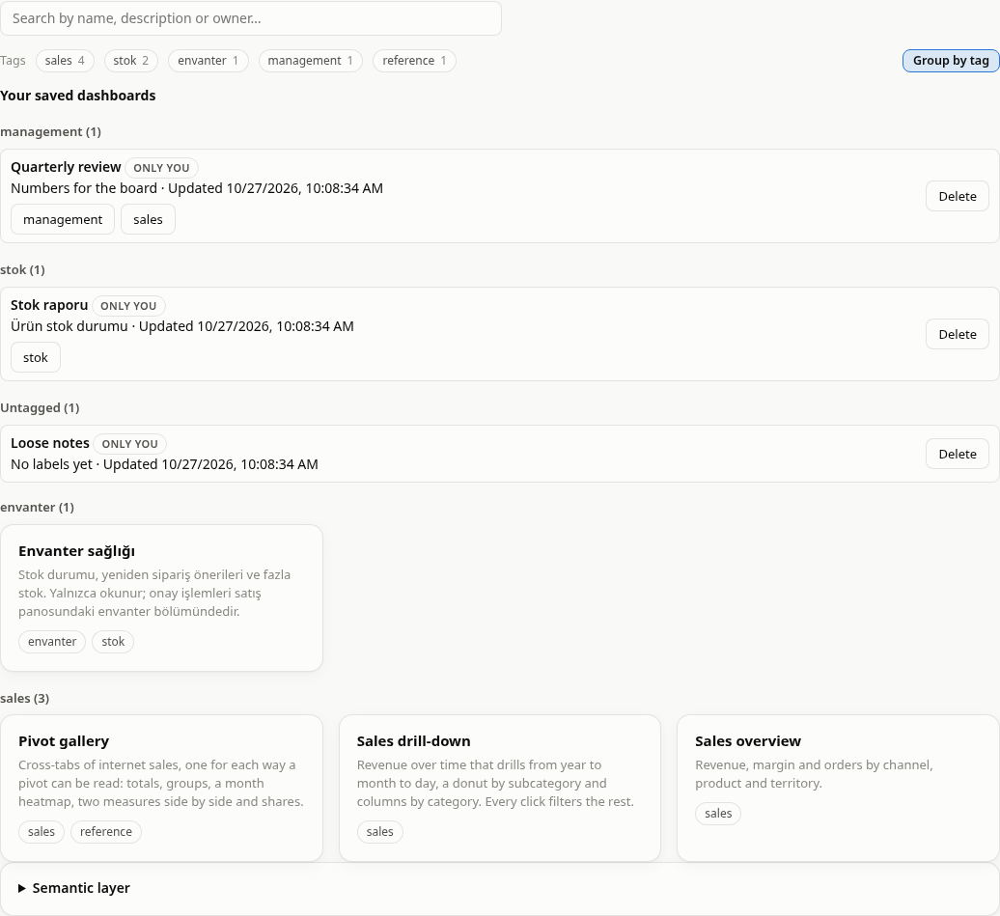

## Anatomy of a file

```yaml
spec: 1
id: sales-overview                 # = the file name = /d/sales-overview
title: Sales overview
tags: [sales]                      # up to 5 short lower-case labels for finding and grouping on /d/ (optional)
locale: en-US                      # number and date formats, and the page's own words (en, tr)
currency: USD
roles: [admin, manager]            # who sees it listed; what they may read is Cube's decision
time: { dimension: dates.full_date, fiscal_year_start: 7 }
filters:                           # selects above the panels
  - { id: fy, dimension: dates.fiscal_year, label: Fiscal year }
panels:                            # see the gallery
  - { id: kpis, type: kpi, measures: [ ... ] }
layout:                            # rows of 12 columns; every panel once
  - [kpis: 12]
  - [trend: 8, lines: 4]
```

**Measures** come in three forms, for a KPI tile or a time-chart series: `member: cube.measure`; `sum: [a.m, b.m]` (the same measure of two
fact cubes added: Cube cannot join two fact cubes in one query, so the page asks each and adds the answers); and
`ratio: { num: [...], den: [...] }` (a margin over both channels). Nothing more: there is no arithmetic in a spec. If you need another
combination, it is a measure in the Cube model (see [adding a metric](#adding-a-metric-to-cube-first)).

**Formats:** `money` (compact on tiles and bars, whole units in tables), `int`, `pct` (a *fraction*: 0.153 shows 15.3%, so use a `ratio`, not a
measure that already holds percentage points), `decimal`, `number`.

**Filters** are selects; a value goes in the URL (`?fy=2021&region=Canada`) so a view can be shared. A filter applies to every panel whose
measures can join to its dimension; for a panel that cannot, list the filter in that panel's `ignore_filters` (the validator tells you).
`parent` groups a filter's options under another dimension, and narrows them when the dashboard has a filter on that dimension too.

**Drill down:** `drill: [year, month, day]` on a time chart. A click on a point opens the next, finer level for that period and, at the same time, filters every other panel
to that date range (the "period", shown as a chip and kept in the URL); a trail above the chart (`All › 2020 › Mar 2020`) goes back up, the chip's x clears it, and
a panel that should not follow lists `period` in its `ignore_filters`. On the last level a click picks one day. Years are calendar years. Chart styles: `line`,
`area`, `stacked-area`, `bar`, `stacked-bar`.

**Click to filter:** `on_click: { set_filter: <id> | [<id>, <id>] }` makes marks clickable. A click sets those filters from what was clicked;
clicking again undoes it and brings back what they held before. The clicked panel does not narrow itself with the filters it sets, so it keeps
showing every choice and marks the selected one. What a click carries: a bar its `by` value, a treemap tile its `group` values in order
(a heading only the first), a table row its dimension columns, a month its fiscal or calendar year.

## Panel gallery

| | |
|---|---|
| **`kpi`**: one tile per measure, optional sparkline. Each tile loads on its own. | 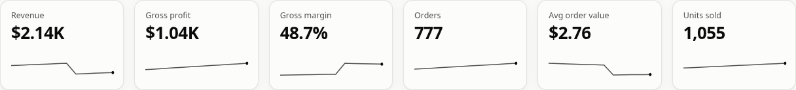 |
| **`timeseries`**: line, bar or stacked bar over a granularity (`granularities` adds a switch); a click sets a year filter. | 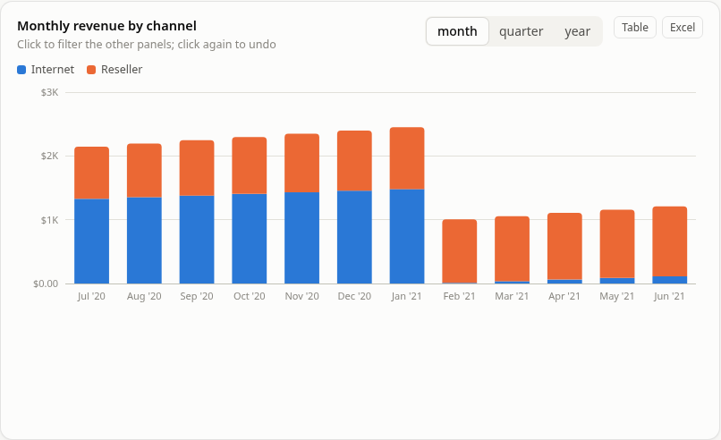 |
| **`timeseries`, `style: line`** with a `ratio` series: a margin over both channels. | 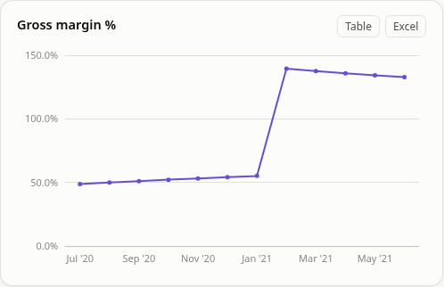 |
| **`timeseries` with `drill: [year, month, day]`**: a click opens the next level for that period, a trail goes back up, and every other panel follows the period. | 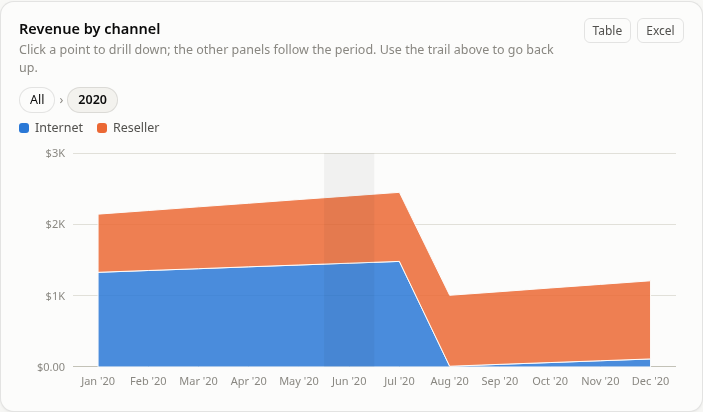 |
| **`bar`**: ranked; one `measure`, a `stack` of measures from several cubes, or a `split` by a dimension; `orientation: vertical` draws columns. | 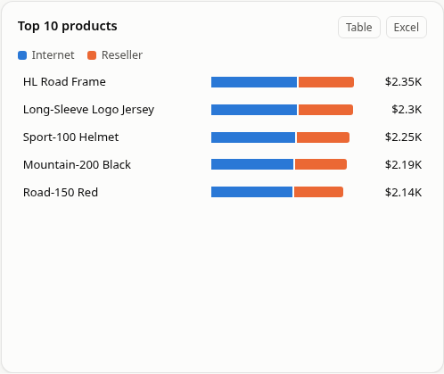 |
| **`pie`** (`style: pie` or `donut`): slices by a dimension, the tail grouped as "Other"; a click filters. | 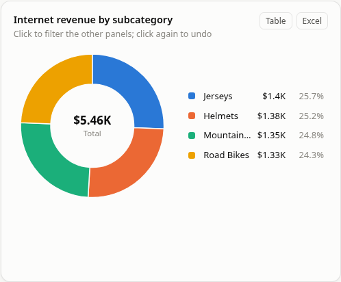 |
| **`treemap`**: one or two dimensions; with two, tiles sit under headings. | 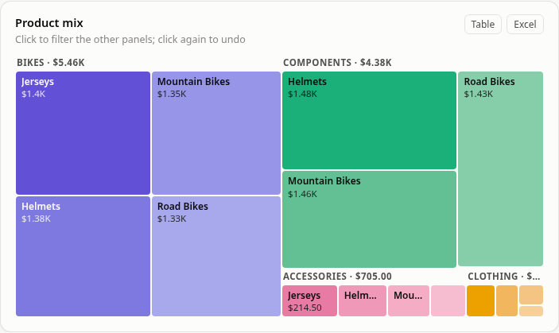 |
| **`table`**: members or `{ member, label, format }`, `order`, `limit`; `totals: header\|footer` adds a bold, frozen total row; readers sort by clicking a column title; a row can set filters. | 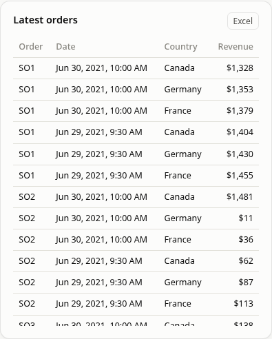 |
| **`pivot`**: one or two `rows` dimensions down the side, one `columns` dimension across the top, one to three `measures` in the cells, a Total column and a frozen, bold total row. A cell, a row name or a column title sets filters. Totals come from Cube over the whole set, so a ratio is the ratio of the totals. See the variants below. | 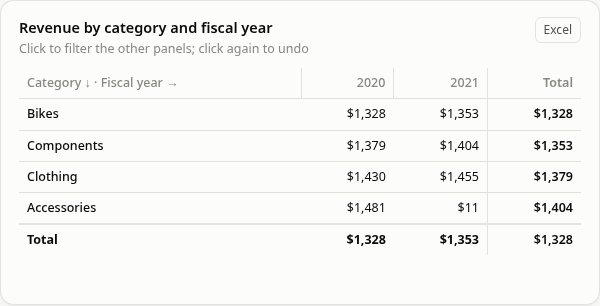 |
| **`pivot`, two `rows`**: the first groups the second; a group row has its own figures. | 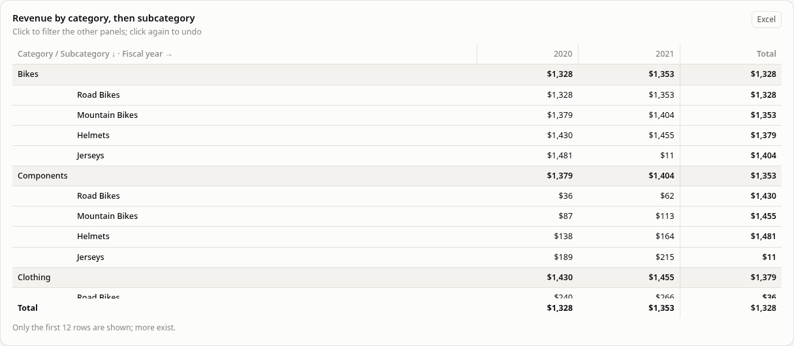 |
| **`pivot` with `columns: { member, granularity }` and `heat: { measure }`**: months across the top and the cells shaded from the smallest to the largest (the number stays in every cell; totals are not shaded). | 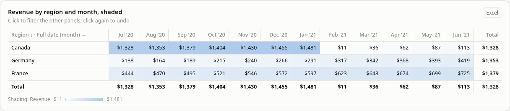 |
| **`pivot` with several `measures`**: each column shows all of them, side by side. | 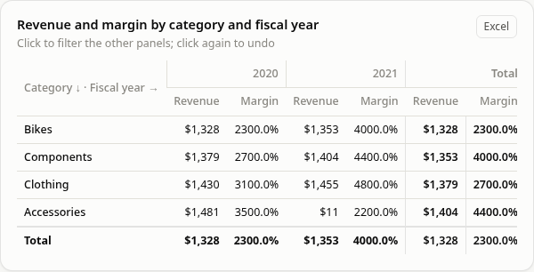 |
| **`pivot` with `show: share_of_column`** (or `share_of_row`, `share_of_total`): the cells as percentages of a total. Needs the total asked for in `totals` and measures that add up (`sum`, `count`). | 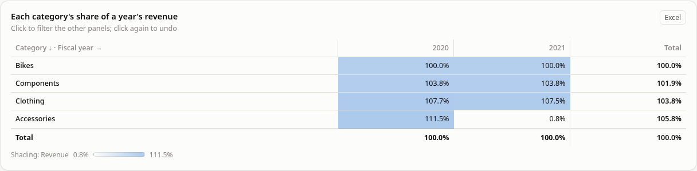 |
| **`text`**: a short Markdown note. | 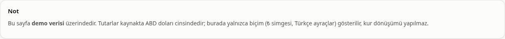 |
| **Filters** above the panels, with Reset when one is set. | 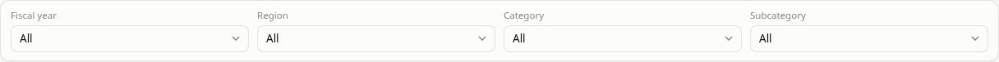 |

Every panel has a loading state (dimmed), an error state (the message, in its card, while the rest of the page draws), a Table view of the same
rows and an Excel button; the header has Export all, a refresh, the theme toggle and, when two datasets are served, the dataset switch.

### Language, currency, theme
`locale: tr-TR` and `currency: TRY` give Turkish separators, month names, the lira sign and the page's own words in Turkish (titles and labels
are yours to write in Turkish). Currency is display only: amounts are not converted, so say so on the page when the data is in another
currency ([`envanter-sagligi.yml`](../dashboards/envanter-sagligi.yml) has a note panel for it). `theme` sets a name, a logo and colours (the dashboard's own look; the viewer's light/dark choice is separate, see [Themes](#themes)).

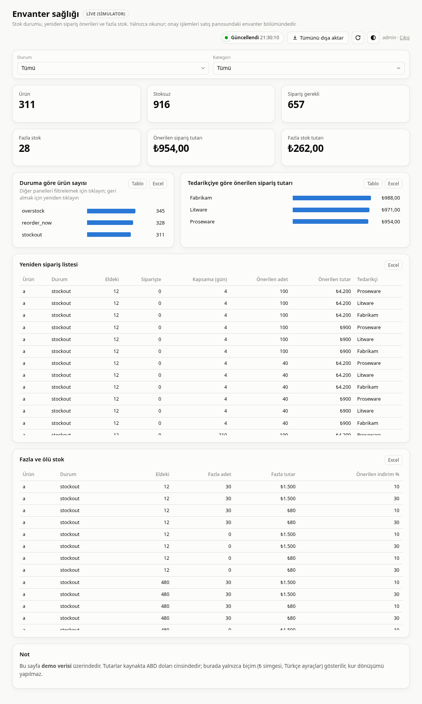

On a phone every panel takes a full row:

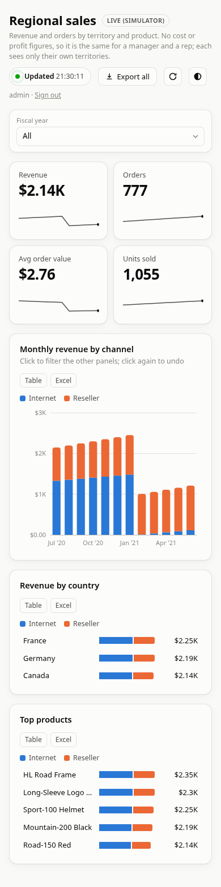

## Roles and security
- Data access is **Cube's**: the page sends the user's own token, `cube/cube.js` filters rows by territory and refuses what a role may not
  read. The spec cannot widen it, and the renderer adds nothing to it.
- `roles:` decides who sees the dashboard listed (and gets "not available for your role" if they open it anyway; no query is sent).
  The validator checks each listed role against the same rules as Cube (a rep has no profit members, purchasing and marketing only
  inventory data, marketing no supplier data, managers and reps no inventory), so a page that would show an error to a role it lists does
  not validate. A test keeps that list equal to `cube/cube.js`.
- A tile or panel whose query Cube refuses shows Cube's message ("Profit and margin are not available for your role") instead of a
  number; the rest of the page still draws.
- Demo data only until InfoSec has approved real data ([`SECURITY.md`](../SECURITY.md)).

## Adding a metric to Cube first
If the page needs a number the model does not have, **do not approximate it in the spec**; add it to the model in its own PR, then use it.

1. **The measure.** Add it to the cube in `cube/model/cubes/<cube>.yml` (for the two sales facts, to both `internet_sales.yml` and
   `reseller_sales.yml`, with the same name, so a `sum` across them works). A new column needs a dbt change first
   (`dbt/adventureworks_starrocks/models/marts/` and its tests).
2. **The 250M dataset.** It runs the model in `spike/cube/model` (plus the two inventory cubes of `cube/model`), so a sales measure must be
   added there too, or the dashboard fails on the benchmark dataset.
3. **A rollup.** An unserved query scans the fact table: fine on the live mart, seconds at 250M rows. Add the measure to the
   pre-aggregations that serve your panels (or add one), then `scripts/dashspec lint dashboards/<id>.yml --cube-url ...` shows what is
   still unserved. A changed rollup is rebuilt; set a new `CUBE_PREAGG_SCHEMA` in `.env` to force a full rebuild of old partitions
   (see `.env.example`).
4. **Who may see it.** If it is sensitive, add it to `PROFIT_MEMBERS` or `SUPPLIER_MEMBERS` in `cube/cube.js` and to
   `dashboards/dashspec/validate.py`; the test that compares the two fails until both agree.
5. **Check it.** `cube/tests` (row-level security) and `spike/cube/check.py` (Cube equals direct SQL) need the stack; then
   `docker compose --profile starrocks up -d cube` to load the model.

## Deploying
The compiled JSON in `dashboards/build/` is committed (a test fails if it is stale) and nginx in the `dashboard-cube` service reads it on
each request, so a deploy is `git pull`. The **first** deploy of this feature needs `docker compose up -d dashboard-cube` (new mount and routes).
Nothing else changes: Keycloak's redirect URIs already cover `/d/*`, the public Caddy front door sends everything that is not `/kc`,
`/auth-api`, `/actions-api` or `/cubejs-*` to the dashboard, and `?dataset=250m` or the header switch picks the dataset exactly as on `/`:
a spec names cubes, never schemas, so every dashboard works on both. See [deploy-demo.md](deploy-demo.md).

## Testing and CI
| What | Command |
|---|---|
| Spec: validator, compiler, roles, lint (stub Cube), the Python query mirror vs the page's own builders, the committed build is current | `PYTHONPATH=dashboards uv run --with pytest --with pyyaml --with 'jsonschema>=4.18' python -m pytest dashboards/tests -q` |
| Page logic: formatting, chart geometry, queries, clicks, translations (node) | `node --test dashboard/cube/tests/*.test.mjs` |
| The renderer in a real Chrome against a mock stack (every panel, filters, clicks, errors, roles, language, theme, widths) | `uv run --with playwright python -I dashboard/cube/tests/renderer.py` |
| Look at any dashboard | `... dashboard/cube/tests/shot.py <id> --role rep --width 390` |
| Regenerate this page's images / the field reference | `... dashboard/cube/tests/gallery.py` / `scripts/dashspec docs` |

CI runs them in the `dashspec` and `dashboard-ui` jobs. Neither runs against the real Cube and Keycloak: after a deploy, open the page next to
`/` as `admin`, `na_manager` and `de_rep` and compare the figures.

## When something looks wrong
| You see | It means |
|---|---|
| The validator: `'x.y' is not in the Cube model (... has: ...)` | A member name is wrong, or the model lacks it: `scripts/dashspec meta`. |
| The validator: `cube 'a' has no join to 'b' ... Add the filter id to this panel's ignore_filters` | A filter's dimension is not reachable from that panel's measures. |
| The validator: `role 'rep' cannot read '...'` | The page lists a role Cube would refuse for that member. Remove the role or the member. |
| A tile shows `—` and a message | Cube refused or failed that query (the message is Cube's; a role limit is a 403). |
| A panel shows `⚠` and a message | The same, for a whole panel. The rest of the page is unaffected. |
| A filter select is empty | No panel applies that filter (all ignore it), so there is nothing to read its values from. |
| Orders / Avg order value arrive last | They use the exact distinct count, which a rollup cannot serve; each tile loads on its own. On the 250M dataset use a measure a rollup serves, or accept the wait. |
| Sign-in loops | The page's address is not among the Keycloak client's redirect URIs (`PUBLIC_URL/*`). |
| `/d/x` says there is no dashboard | `dashboards/build/x.json` is missing: run `scripts/dashspec build` and commit it. |

## Not in v1
Comparison with the previous period on KPI tiles; per-panel time dimensions; fixed (non-selectable) filters in a spec; folding small treemap
tiles into "Other"; languages other than English and Turkish for the page's own words; currency conversion; scheduled e-mail reports, PDF
export, alerts (out of scope on purpose: [the plan](dashboard-spec-plan.md#non-goals)). A new panel type needs two real use cases.
